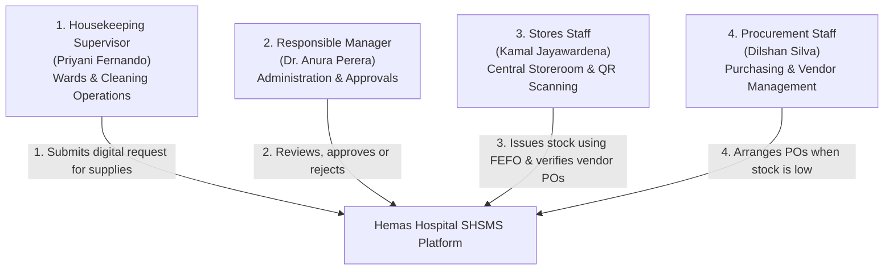

# 🏥 SHSMS Viva Presentation & Demonstration Guide
## Smart Housekeeping Supply Management System — Hemas Hospital, Thalawathugoda

> **Purpose of this Guide:**  
> This document is designed for your **Viva / Non-Technical Oral Presentation**. It provides a clear, jargon-free explanation of **what problem the system solves**, **who uses it**, a **step-by-step live demonstration script with concrete examples**, and **answers to common questions examiners ask**.

---

## 📌 Table of Contents
1. [The Big Picture: What Problem Does This System Solve?](#1-the-big-picture-what-problem-does-this-system-solve)
2. [Before vs. After SHSMS (The Real-World Hospital Impact)](#2-before-vs-after-shsms-the-real-world-hospital-impact)
3. [The 4 Key Hospital Roles (Who Uses the System?)](#3-the-4-key-hospital-roles-who-uses-the-system)
4. [The 7-Step Live Demo Storyline (What to Show in 5–8 Minutes)](#4-the-7-step-live-demo-storyline-what-to-show-in-58-minutes)
5. [Core Concepts Explained in Plain English (FEFO, QR, Ledger)](#5-core-concepts-explained-in-plain-english)
6. [Top Viva Questions & Confident Model Answers](#6-top-viva-questions--confident-model-answers)
7. [Quick 30-Second Elevator Pitch (Memorize This!)](#7-quick-30-second-elevator-pitch)

---

## 1. The Big Picture: What Problem Does This System Solve?

In a major healthcare institution like **Hemas Hospital, Thalawathugoda**, cleanliness is not just about appearances — **it is a matter of life and death**. Infection Prevention and Control (IPC) depends entirely on having the right cleaning chemicals, disinfectants, PPE, and mop heads available at the exact second they are needed.

### 🔴 The Critical Problems Hospitals Face Without This System:
1. **Critical Stockouts in Operating Theaters & ICUs:**
   - *Example:* If Intensive Care Unit (ICU) runs out of hospital-grade chlorine disinfectant because someone forgot to place an order, surgical theaters cannot be sanitized between procedures.
2. **Expired Chemical Wastage (Financial & Safety Hazard):**
   - *Example:* Storeroom staff accidentally grab newer bottles from the front of the shelf while older bottles at the back sit past their expiration date. Expired disinfectants lose their chemical potency, failing to kill hospital pathogens, and must be thrown away — costing millions of rupees annually.
3. **Paper Chits & Verbal Requests Cause Delays:**
   - Housekeeping supervisors previously walked around with paper requisition slips or sent verbal WhatsApp messages to get approvals. Requests were lost, delayed, or unrecorded.
4. **Unchecked Vendor Deliveries:**
   - When suppliers deliver 50 bottles, but 5 are damaged/leaking or only 40 were actually in the boxes, paper logs failed to catch the discrepancy. The hospital ended up paying for missing or damaged goods.
5. **No Audit Trail for Hospital Management:**
   - Management had no real-time visibility into who approved what, where 100 liters of floor cleaner went, or why a ward consumed 3× more supplies this month than last month.

---

## 2. Before vs. After SHSMS (The Real-World Hospital Impact)

| Operational Area | The "Old Way" (Manual / Paper / Spreadsheets) | The "New Way" (Smart SHSMS System) |
| :--- | :--- | :--- |
| **Supply Requests** | Supervisor fills a paper slip, walks to manager's office, waits hours for a signature. | Supervisor taps 3 clicks on phone/desktop. Manager gets an instant digital alert. |
| **Stock Tracking** | Counted by hand on weekly paper cards. Nobody knows the exact stock count right now. | **Real-time digital ledger:** exact live counts by batch and storage rack location. |
| **Stock Rotation** | Staff grab the closest box on the shelf. Older boxes expire at the back. | **Automatic FEFO (First Expired, First Out):** system forces issuance of earliest-expiring stock first. |
| **Low-Stock Alerts** | Discovered only when the storeroom shelf is completely empty. | **Automatic Proactive Alerts:** triggers when stock drops to reorder point so procurement orders before stockouts happen. |
| **Shipment Receiving** | Staff sign delivery slips without checking against the original Purchase Order. | **Digital PO Verification:** checks delivered counts; flags damages/shortages; blocks broken items from usable stock. |
| **Accountability** | Missing items blamed on "clerical errors". | **Immutable Stock Ledger:** Every single movement records timestamp, exact user ID, and before/after balances. |

---

## 3. The 4 Key Hospital Roles (Who Uses the System?)

During the viva, explain that the system connects **4 different departments** with strict role-based permissions:

1. **Housekeeping Supervisor (`Priyani Fernando`):**
   - *Her Job:* Manages ward cleaners and ensures wards, ICUs, and OPD are germ-free.
   - *In SHSMS:* Creates supply requests, monitors status, receives low-stock and expiry warnings.
2. **Responsible Manager (`Dr. Anura Perera`):**
   - *His Job:* Oversees hospital operations, budget, and infection control compliance.
   - *In SHSMS:* Reviews pending requests, approves full/partial quantities, rejects unnecessary requests with reasons, and monitors hospital wastage/spending reports.
3. **Stores Staff (`Kamal Jayawardena`):**
   - *His Job:* Manages physical inventory in the central hospital storeroom.
   - *In SHSMS:* Scans QR codes on boxes, prints QR labels, issues approved supplies following FEFO guidance, and inspects incoming supplier shipments against POs.
4. **Procurement Staff (`Dilshan Silva`):**
   - *His Job:* Liaises with chemical and equipment suppliers, negotiates orders.
   - *In SHSMS:* Receives automatic low-stock reorder triggers, creates Purchase Orders, and handles delivery discrepancy claims when suppliers bring damaged or short shipments.

---

## 4. The 7-Step Live Demo Storyline (What to Show in 5–8 Minutes)

Follow this exact story during your viva. It proves the entire hospital lifecycle works seamlessly.

> 💡 **Demo Tip:** You don't need to log out and type passwords repeatedly. Use the **1-Click Staff Selector** on the Login screen, or the **top-right profile dropdown** in the navbar to switch users instantly!

---

### Step 1: Login & The Clean Hospital Dashboard
- **What to do:**
  1. Open [http://localhost:5173](http://localhost:5173).
  2. Point out the staff sign-in with **Hemas Hospital Thalawathugoda** branding.
  3. Click **Priyani Fernando (Housekeeping Supervisor)** and click **Sign In**.
- **What to say:**
  > *"Examiners, welcome to the Hemas Hospital Smart Housekeeping Supply Management System. We are currently logged in as Priyani Fernando, a Housekeeping Supervisor on the hospital floor. Notice the modern, focused glassmorphic design and stationary pastel network background that provides an uncluttered, high-contrast operational dashboard."*

---

### Step 2: Supervisor Submits a Digital Supply Request
- **What to do:**
  1. Click **Requests** in the top navigation.
  2. Click the **+ New Supply Request** button.
  3. Select **Bleach Solution (Chlorine 5%)**, Quantity: **5**, Target Area: **ICU Ward 3 - Floor 2**, Purpose: **Emergency terminal disinfection after patient discharge**, Urgency: **URGENT**.
  4. Click **Submit Supply Request**.
- **What to say:**
  > *"Previously, Priyani had to write a paper requisition chit, walk across three hospital wings, and hunt for a manager. With SHSMS, she submits the request digitally in 15 seconds. The system automatically performs a real-time stock check, confirming whether the central storeroom has enough bottles or if Procurement must be notified."*

---

### Step 3: Switch to Responsible Manager for 1-Click Approval
- **What to do:**
  1. Click the top-right profile icon in the navbar.
  2. Select **Dr. Anura Perera (MANAGER)** to switch instantly.
  3. Go to **Dashboard** or **Requests**.
  4. See Priyani's request at the top of the queue marked with an **URGENT** badge.
  5. Click **Approve Full** (or show partial approval).
- **What to say:**
  > *"We have switched to Dr. Anura Perera, our Operations Manager. He immediately sees the notification on his dashboard. With a single click, Dr. Anura reviews the clinical purpose and approves it. The system automatically routes the approved request directly into the storeroom queue for dispatch."*

---

### Step 4: Stores Staff Issues Stock with FEFO (First Expired, First Out)
- **What to do:**
  1. Switch role to **Kamal Jayawardena (STORES_STAFF)**.
  2. On the **Dashboard** or **Requests** tab, see the approved ICU request ready for fulfillment.
  3. Click **Issue Stock (FEFO)**.
  4. In the dialog, point out how the system **automatically selects the batch with the earliest expiration date** and highlights it as recommended.
  5. Show that expired batches are locked/quarantined and cannot be selected.
  6. Click **Confirm FEFO Issue**.
- **What to say:**
  > *"Now we are Kamal in the central storeroom. This is the heart of hospital safety: **FEFO (First Expired, First Out)**. The system prevents human error by mathematically ordering active batches by expiration date. Kamal does not have to guess which box is oldest; the system enforces that the batch expiring soonest is used first, completely eliminating expired chemical waste."*

---

### Step 5: QR Code Label Printing & Mobile Camera Scanning
- **What to do:**
  1. Click **Inventory** in the navigation bar.
  2. Find an item (e.g. *Bleach Solution* or *Heavy Duty Nitrile Gloves*).
  3. Click the **QR Code icon** on that item.
  4. Show the printable hospital label view with hospital heading, SKU, location, and high-resolution QR code. Click **Print Label** to show the browser print dialog.
  5. Click **Scan QR** in the top navbar. Show the scanner dialog with camera support and manual SKU input fallback (type e.g. `HEM-CHM-001` and click **Lookup**).
- **What to say:**
  > *"Every item, storage bin, and batch in Hemas Hospital gets a unique QR code. Storeroom staff can print QR labels directly from the system and stick them onto shelves or chemical boxes. When doing rounds, staff can scan the label using a tablet camera or handheld scanner to instantly pull up live stock counts, shelf locations, and active batches in under one second."*

---

### Step 6: Vendor Delivery Verification with Damaged Goods Handling
- **What to do:**
  1. Click **Purchase Orders** in the navigation bar.
  2. Select an open PO (e.g. `PO-2026-001` from *Hemas Healthcare Supplies Ltd*).
  3. Click **Inspect & Verify Delivery**.
  4. Show the inspection form:
     - Ordered Quantity: **100**
     - Received Quantity: Enter **90** (Shortage of 10)
     - Condition: Select **DAMAGED**
     - Discrepancy Note: Enter **"10 units missing; 5 bottles leaked in transit"**
  5. Click **Submit Verification**.
  6. Point out that the PO is immediately flagged with a red **DISCREPANCY FLAGGED** badge, an automated alert is sent to Procurement, and **damaged units are NOT added to usable stock**.
- **What to say:**
  > *"When suppliers arrive at the loading bay, Kamal inspects the delivery against the approved Purchase Order. If there is a shortage or leaking bottles, the system creates an immutable discrepancy record and alerts Procurement. Crucially, the system ensures zero contaminated or broken items enter active hospital inventory."*

---

### Step 7: Real-Time Operational Reports & One-Click CSV Export
- **What to do:**
  1. Switch back to **Dr. Anura Perera (MANAGER)** or **Dilshan Silva (PROCUREMENT_STAFF)**.
  2. Click **Reports** in the navigation bar.
  3. Show the **5 Management Reports**:
     - **Stock Availability:** live inventory across Chemicals, Equipment, Consumables, PPE.
     - **Monthly Consumption:** exact quantities consumed by ICU, OPD, and surgical wards.
     - **Stock Shortages:** tracking low-stock events and lead times.
     - **Procurement Performance:** supplier reliability and discrepancy rates.
     - **Material Wastage:** log of expired or damaged items.
  4. Click **Export CSV** to show that reports can be downloaded into Excel for hospital board meetings and budget planning.
- **What to say:**
  > *"Finally, hospital leadership has complete transparency. With five real-time reports and one-click CSV export, management can accurately forecast next month's cleaning chemical budget based on actual ward consumption trends rather than guesswork."*

---

## 5. Core Concepts Explained in Plain English

Examiners love asking about concepts. Here is how to explain them simply:

### 1. What is FEFO and why does a hospital need it?
> *"FEFO stands for **First Expired, First Out**. Unlike a grocery store or retail warehouse that might use FIFO (First In, First Out), a hospital deals with medical-grade disinfectants, sterile consumables, and hand sanitizers that have strict chemical expiration dates. FEFO ensures that whatever stock expires earliest is dispatched first. This guarantees active chemical potency for patient safety and prevents costly wastage."*

### 2. What is an Immutable Stock Ledger?
> *"In financial accounting, you cannot simply erase transactions; every deposit and withdrawal has a permanent record. We applied the exact same standard to Hemas Hospital's supplies. Every stock receipt, issue, adjustment, or disposal creates a permanent, un-editable row in our `stock_ledger` table with timestamp, user ID, quantity change, and resulting balance. This prevents inventory theft and provides 100% auditability."*

### 3. What is Automated Reorder Point (ROP)?
> *"The Reorder Point is a safety threshold. For example, if Hemas Hospital consumes 5 bottles of floor disinfectant per day and it takes the supplier 3 days to deliver, the reorder threshold might be 20 bottles. The instant stock drops to 20 or below, SHSMS automatically notifies Procurement and Housekeeping so an order is placed **before** the hospital runs out."*

### 4. What is Role-Based Access Control (RBAC)?
> *"Not everyone should have permission to approve orders or alter stock counts. RBAC ensures strict security: Housekeeping Supervisors can request supplies, but only Managers can approve them. Stores Staff can issue stock and inspect deliveries, but cannot alter purchase orders. This enforces hospital separation of duties."*

---

## 6. Top Viva Questions & Confident Model Answers

### Q1: "Why did you build a custom web system instead of using a standard spreadsheet like Excel?"
> **Answer:** *"Spreadsheets cannot enforce business rules. In Excel, multiple users cause file lock conflicts; anyone can accidentally delete rows or change numbers without an audit trail; and Excel cannot automatically block someone from issuing an expired batch or trigger real-time push alerts to mobile phones. SHSMS uses an ACID-compliant transactional database that enforces FEFO, audit logs, and role permissions simultaneously."*

---

### Q2: "What happens if a storeroom worker's device has no working camera for QR scanning?"
> **Answer:** *"We designed the system with resilience. Every QR code encodes the item's unique SKU (e.g. `HEM-CHM-001`). If the camera is unavailable or lighting in the storeroom is poor, the worker can simply type the SKU into the manual input box in the scanner modal, or use a standard USB barcode reader. Both yield the exact same instant item lookup."*

---

### Q3: "How does this system support Infection Prevention and Control (IPC) standards?"
> **Answer:** *"IPC requires two things: consistent availability of sanitization chemicals and guaranteed potency. SHSMS directly prevents stockouts of critical cleaning chemicals in ICUs and surgical wards via automated reorder alerts, and guarantees chemical potency by enforcing FEFO and automatically quarantining expired batches so sub-potent disinfectants are never used on patient surfaces."*

---

### Q4: "Can a Housekeeping Supervisor approve their own requests?"
> **Answer:** *"No. The system enforces strict separation of duties through backend RBAC middleware. Even if a supervisor attempts to call the approval endpoint directly, the backend returns a `403 Forbidden` response. Only authenticated users with the `MANAGER` or `ADMIN` role can approve requests."*

---

### Q5: "How does the system handle supplier discrepancies like shortages or damages?"
> **Answer:** *"During delivery inspection, Stores Staff enter the actual received quantity and condition. If only 40 out of 50 units arrive, or if 5 bottles leaked in transit, the system immediately flags the PO as `DISCREPANCY_FLAGGED` and alerts Procurement to seek supplier credit. Most importantly, damaged units are never added to active inventory — only verified, good-condition stock is made available for hospital use."*

---

### Q6: "Is the system responsive on mobile devices?"
> **Answer:** *"Yes. Storeroom staff and ward supervisors frequently work on their feet with tablets or smartphones. The entire website is optimized for mobile screens using dynamic viewport scaling (`100dvh`), a touch-friendly navigation bar, horizontal table swiping, and focused glassmorphism cards that maintain high readability under any screen size."*

---

## 7. Quick 30-Second Elevator Pitch (Memorize This!)

If an examiner asks: *"Give me a 30-second summary of what your project does"*, say this:

> *"The **Smart Housekeeping Supply Management System (SHSMS)** is a centralized digital platform built for **Hemas Hospital, Thalawathugoda**. It replaces error-prone paper slips and manual stock cards with an end-to-end digital workflow. It connects Housekeeping Supervisors, Managers, Stores, and Procurement to manage supply requests, automate low-stock reorder alerts, inspect vendor deliveries against Purchase Orders, and enforce **FEFO stock rotation** so cleaning chemicals never expire on hospital shelves. In short: it saves operational costs, eliminates chemical wastage, and guarantees the highest standards of hospital infection control."*

---

### 🎓 Final Viva Checklist Before You Begin:
- [ ] Both servers are running: Backend on port 5000 (`http://localhost:5000/api/health`), Frontend on port 5173 (`http://localhost:5173`).
- [ ] Have the website open in your browser in full screen.
- [ ] Familiarize yourself with the **1-Click Staff Selector** (Priyani, Dr. Anura, Kamal, Dilshan).
- [ ] Remember: **Speak about hospital problems and real human impact first, then show how the site cleanly solves them.**
