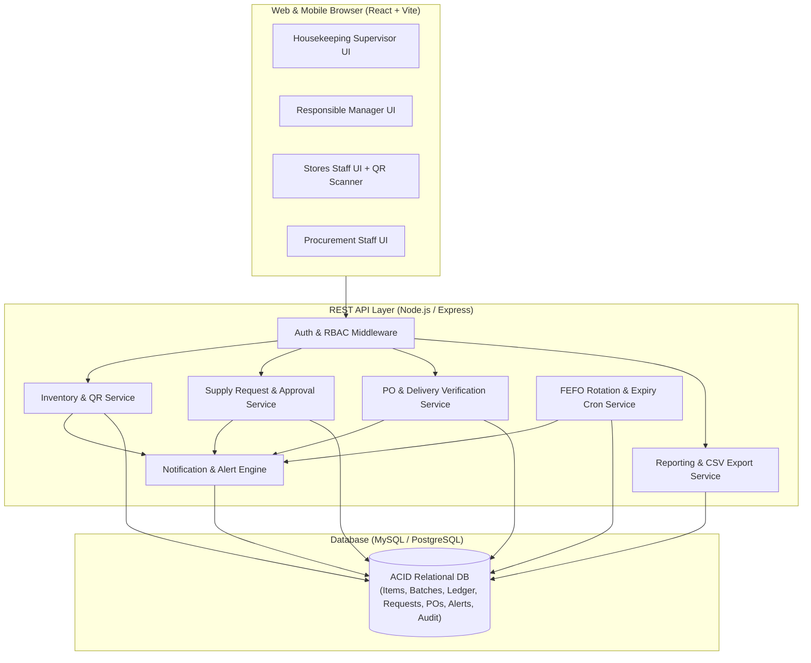

# System Architecture Blueprint — SHSMS (4-Day Rapid Build)

## 1. Recommended Technology Stack
Optimized for rapid 4-day delivery, high reliability, and mobile-friendly QR scanning:
- **Frontend:** React + Vite + TypeScript + Tailwind CSS
  - QR Scanning: `html5-qrcode` (uses device camera via WebRTC) + manual code fallback
  - QR Generation: `qrcode.react` (with print-friendly label layout)
  - Charts & Reporting: `recharts` + CSV export utility
- **Backend:** Node.js + Express (or Fastify) REST API
  - Auth & RBAC: JWT (HTTP-only cookies or Bearer token) + `bcrypt` password hashing
  - Scheduled Jobs: `node-cron` for daily expiry checks (30/14/7-day warnings & auto-quarantine)
- **Database:** MySQL 8.0 or PostgreSQL 15+ (with Prisma or Knex for fast migrations & ACID transactions)

## 2. Logical Component Architecture

## 3. Core API Endpoint Blueprint

| Module | Method & Path | Allowed Roles | Purpose |
| :--- | :--- | :--- | :--- |
| **Auth** | `POST /api/auth/login` | Public | Authenticate user & return JWT + role |
| **Auth** | `GET /api/auth/me` | All Authenticated | Fetch current user profile & role |
| **Inventory** | `GET /api/items` | All Authenticated | List items with total stock, location & reorder status |
| **Inventory** | `POST /api/items` | `STORES_STAFF`, `ADMIN` | Register new item & generate QR payload |
| **Inventory** | `GET /api/items/qr/:code` | `STORES_STAFF`, `HOUSEKEEPING_SUPERVISOR` | Instant lookup by scanned QR code |
| **Batches** | `GET /api/items/:id/batches` | `STORES_STAFF`, `MANAGER`, `PROCUREMENT_STAFF` | List batches sorted by `expiry_date ASC` (FEFO) |
| **Requests** | `POST /api/requests` | `HOUSEKEEPING_SUPERVISOR` | Submit digital supply request |
| **Requests** | `GET /api/requests` | All Authenticated (filtered by role) | View requests queue |
| **Requests** | `PATCH /api/requests/:id/decision` | `MANAGER` | Approve (full/partial) or Reject with reason |
| **Issuance** | `POST /api/requests/:id/issue` | `STORES_STAFF` | Issue approved items using FEFO batch deduction |
| **POs** | `POST /api/purchase-orders` | `PROCUREMENT_STAFF` | Create approved PO for replenishment |
| **Delivery** | `POST /api/purchase-orders/:id/verify` | `STORES_STAFF` | Verify delivery vs PO, log batch/expiry & discrepancies |
| **Alerts** | `GET /api/alerts` | All Authenticated (filtered by role) | Fetch active Low-Stock, Expiry, & Discrepancy alerts |
| **Reports** | `GET /api/reports/:type` | `MANAGER`, `HOUSEKEEPING_SUPERVISOR`, `PROCUREMENT_STAFF`, `STORES_STAFF` | Availability, Monthly Consumption, Shortages, Procurement, Wastage |
