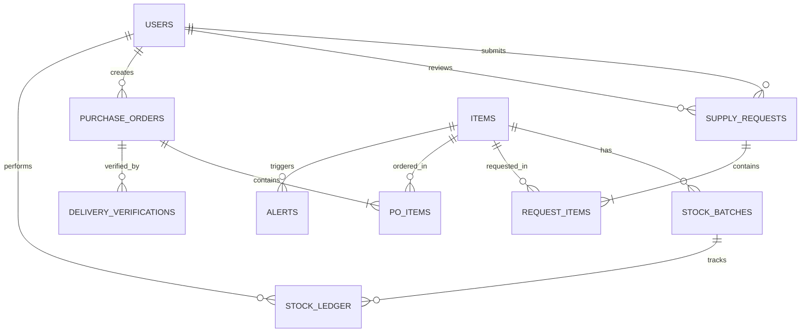

# Database Design Specification — SHSMS

## 1. Entity-Relationship Overview

## 2. Logical Table Definitions

### `users`
| Column | Type / Constraints | Notes |
| :--- | :--- | :--- |
| `id` | Primary Key (UUID / INT) | Unique user identifier |
| `full_name` | VARCHAR(120), NOT NULL | Staff full name |
| `email` | VARCHAR(150), UNIQUE, NOT NULL | Login email |
| `password_hash` | VARCHAR(255), NOT NULL | Bcrypt/Argon2 hash |
| `role` | ENUM, NOT NULL | `HOUSEKEEPING_SUPERVISOR`, `MANAGER`, `STORES_STAFF`, `PROCUREMENT_STAFF`, `ADMIN` |
| `is_active` | BOOLEAN, DEFAULT TRUE | Account status |
| `created_at` | TIMESTAMP | Record creation time |

### `items`
| Column | Type / Constraints | Notes |
| :--- | :--- | :--- |
| `id` | Primary Key | Unique item ID |
| `sku` | VARCHAR(50), UNIQUE, NOT NULL | Internal SKU (e.g., `HEM-CHM-001`) |
| `name` | VARCHAR(150), NOT NULL | Item name |
| `category` | ENUM, NOT NULL | `CHEMICAL`, `EQUIPMENT`, `CONSUMABLE`, `PPE` |
| `unit` | VARCHAR(30), NOT NULL | `Liters`, `Bottles`, `Boxes`, `Pairs`, `Units` |
| `storage_location` | VARCHAR(100), NOT NULL | Rack / Room location in Stores |
| `min_stock_level` | INT, NOT NULL | Safety floor |
| `reorder_point` | INT, NOT NULL | Triggers `LOW_STOCK` alert when `total_qty <= reorder_point` |
| `tracks_expiry` | BOOLEAN, NOT NULL | Mandatory `TRUE` for chemicals & perishables |
| `qr_code_value` | VARCHAR(150), UNIQUE, NOT NULL | Encoded QR payload (e.g., `SHSMS:ITEM:HEM-CHM-001`) |

### `stock_batches`
| Column | Type / Constraints | Notes |
| :--- | :--- | :--- |
| `id` | Primary Key | Unique batch ID |
| `item_id` | Foreign Key -> `items.id` | Parent item |
| `batch_number` | VARCHAR(80), NOT NULL | Manufacturer / delivery batch code |
| `initial_qty` | INT, NOT NULL | Quantity originally received |
| `remaining_qty` | INT, NOT NULL, CHECK >= 0 | Current usable quantity in this batch |
| `expiry_date` | DATE, NULLABLE | Required if `items.tracks_expiry = TRUE` |
| `received_date` | DATE, NOT NULL | Date received into Stores |
| `po_id` | Foreign Key -> `purchase_orders.id` (NULLABLE) | Linked PO if received via procurement |
| `status` | ENUM, NOT NULL | `ACTIVE`, `EXPIRING_SOON`, `EXPIRED`, `DEPLETED` |

### `supply_requests` & `request_items`
- `supply_requests`: `id`, `request_code`, `requested_by` (FK `users`), `purpose`, `urgency` (`NORMAL`, `URGENT`), `status` (`PENDING`, `APPROVED`, `REJECTED`, `PARTIALLY_ISSUED`, `FULFILLED`), `reviewed_by` (FK `users`), `reviewed_at`, `rejection_reason`, `created_at`.
- `request_items`: `id`, `request_id` (FK), `item_id` (FK), `requested_qty`, `approved_qty`, `issued_qty`.

### `purchase_orders`, `po_items`, & `delivery_verifications`
- `purchase_orders`: `id`, `po_number` (UNIQUE), `supplier_name`, `created_by` (FK), `expected_date`, `status` (`OPEN`, `PARTIALLY_RECEIVED`, `VERIFIED`, `DISCREPANCY_FLAGGED`), `created_at`.
- `po_items`: `id`, `po_id` (FK), `item_id` (FK), `ordered_qty`, `received_qty`.
- `delivery_verifications`: `id`, `po_id` (FK), `item_id` (FK), `verified_by` (FK), `received_qty`, `condition` (`GOOD`, `DAMAGED`, `DEFECTIVE`, `WRONG_ITEM`), `batch_number`, `expiry_date`, `discrepancy_note`, `verified_at`.

### `stock_ledger` (Immutable Audit Trail)
| Column | Type / Constraints | Notes |
| :--- | :--- | :--- |
| `id` | Primary Key | Ledger entry ID |
| `item_id` | Foreign Key -> `items.id` | Item affected |
| `batch_id` | Foreign Key -> `stock_batches.id` | Specific batch affected |
| `movement_type` | ENUM, NOT NULL | `RECEIPT`, `ISSUE`, `WASTAGE`, `ADJUSTMENT` |
| `quantity_change` | INT, NOT NULL | Positive for receipt, negative for issue/wastage |
| `balance_after` | INT, NOT NULL | Item total balance after transaction |
| `reference_type` | VARCHAR(40) | `SUPPLY_REQUEST`, `PURCHASE_ORDER`, `EXPIRY_DISPOSAL` |
| `reference_id` | INT / UUID | ID of the linked request or PO |
| `performed_by` | Foreign Key -> `users.id` | Staff member who executed the action |
| `notes` | TEXT | Optional FEFO override or wastage reason |
| `created_at` | TIMESTAMP | Immutable timestamp |

### `alerts`
- `id`, `alert_type` (`LOW_STOCK`, `EXPIRY_WARNING`, `EXPIRED`, `DISCREPANCY`, `APPROVAL_NEEDED`), `target_role`, `item_id` (FK), `reference_id`, `message`, `is_resolved` (BOOLEAN), `created_at`.

## 3. Critical Business Rules at DB Layer
1. **FEFO Query Order:** Always fetch issuable batches using `WHERE status IN ('ACTIVE', 'EXPIRING_SOON') AND remaining_qty > 0 AND (expiry_date IS NULL OR expiry_date >= CURRENT_DATE) ORDER BY expiry_date ASC NULLS LAST, received_date ASC`.
2. **Total Stock Calculation:** Item total available stock = `SUM(remaining_qty)` of non-expired batches.
