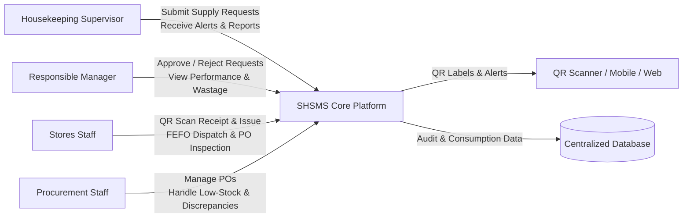
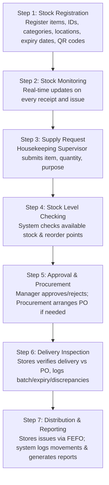

# Software Requirements Specification (SRS)
## Smart Housekeeping Supply Management System (SHSMS)
**Client / Target Organization:** Hemas Hospital, Thalawathugoda  
**Document Version:** 1.0  
**Date:** November 16, 2026  
**Standard:** IEEE Std 830 / ISO/IEC/IEEE 29148  

---

## 1. Introduction

### 1.1 Purpose
This Software Requirements Specification (SRS) defines the complete functional, non-functional, data, and operational requirements for the **Smart Housekeeping Supply Management System (SHSMS)** for **Hemas Hospital, Thalawathugoda**. It serves as the single source of truth for system architects, developers, AI coding agents, and QA reviewers to design, build, and verify the platform within an accelerated delivery timeline.

### 1.2 Scope
SHSMS is a centralized digital inventory, procurement-coordination, and supply-distribution platform tailored to hospital housekeeping operations. It manages the full lifecycle of housekeeping materials—from stock registration and QR-code tagging to digital supply requests, managerial approvals, purchase order (PO) delivery verification, **First Expired, First Out (FEFO)** stock rotation, automatic low-stock and expiry alerts, and management reporting.

**In Scope:**
- Centralized digital inventory for four supply categories: **Cleaning Chemicals**, **Cleaning Equipment**, **Consumables**, and **Personal Protective Equipment (PPE)**.
- QR-code generation and scanning for individual items, batches, or storage containers during stock receipt and issuance.
- Automated reorder-point monitoring and low-stock notifications.
- Digital supply request submission, multi-stage approval/rejection, and routing to Stores or Procurement.
- Delivery inspection and verification against approved Purchase Orders (POs), including discrepancy/damage logging.
- Batch-level expiry tracking, approaching-expiry alerts, and FEFO issuance enforcement.
- Stock usage, shortage, procurement, wastage, and performance reporting.
- Role-Based Access Control (RBAC) and immutable audit logging across Housekeeping, Stores, Procurement, and Management.

**Out of Scope (Phase 1 / 4-Day MVP):**
- Direct financial accounting/ERP ledger integration or automated bank payments to external vendors.
- Patient-level billing or clinical pharmacy inventory (managed by separate hospital systems).
- Automated IoT weight-sensor shelves (replaced by QR-code scan workflows).

### 1.3 Definitions, Acronyms, and Abbreviations
| Term / Acronym | Definition |
| :--- | :--- |
| **SHSMS** | Smart Housekeeping Supply Management System |
| **FEFO** | First Expired, First Out — stock rotation method where batches with the earliest expiry date are issued first |
| **PPE** | Personal Protective Equipment (e.g., gloves, masks, aprons, protective eyewear) |
| **PO** | Purchase Order — approved order sent to a supplier by Procurement |
| **QR Code** | Quick Response 2D matrix barcode attached to items, batches, or storage containers |
| **IPC** | Infection Prevention and Control |
| **Reorder Point (ROP)** | Minimum stock threshold at which an automated replenishment alert is triggered |
| **RBAC** | Role-Based Access Control |

### 1.4 References
- Source Specification: *Chapter 5 – Development of the Proposed Solution (5.docx)*, Hemas Hospital, Thalawathugoda.

### 1.5 Document Overview
Section 2 describes the system context, user roles, operational process, and constraints. Section 3 details all functional requirements, external interfaces, non-functional requirements, and data requirements. Section 4 provides the end-to-end requirements traceability matrix.

---

## 2. Overall Description

### 2.1 Product Perspective
SHSMS replaces manual paper logs, disconnected spreadsheets, and ad-hoc phone/verbal supply requests at Hemas Hospital, Thalawathugoda. It acts as a unified operational hub connecting four hospital functions: **Housekeeping**, **Management**, **Stores**, and **Procurement**.

### 2.2 Product Functions (High-Level Modules)
1. **Digital Inventory Monitoring:** Real-time item and batch registry with QR-code identification, storage locations, and quantity tracking.
2. **Automatic Low-Stock Notifications:** Configurable minimum stock and reorder points per item that alert Housekeeping Supervisors and Procurement Staff.
3. **Digital Supply Request & Approval System:** End-to-end digital workflow for requesting supplies, managerial review, and routing to Stores or Procurement.
4. **Delivery Verification System:** Inspection of incoming vendor deliveries against approved POs, capturing batch/expiry data, item condition, and quantity discrepancies.
5. **Expiry-Date & Stock Rotation Management:** Expiry monitoring with proactive alerts and FEFO-guided stock issuance.
6. **Stock Usage & Performance Reporting:** Operational dashboards and exportable reports covering stock availability, monthly consumption, shortages, procurement activity, and wastage.

### 2.3 User Classes and Characteristics
| Role | Primary Responsibilities in SHSMS | Technical Proficiency & Environment |
| :--- | :--- | :--- |
| **Housekeeping Supervisor** | Submits digital supply requests (item, quantity, purpose); monitors request status; receives low-stock and expiry alerts; reviews consumption reports. | Moderate; uses desktop or tablet/mobile browser in hospital wards/offices. |
| **Responsible Manager** | Reviews pending supply requests and purchase approvals; approves or rejects with remarks; monitors wastage, discrepancies, and forecasting reports. | Moderate to high; uses desktop/laptop browser for oversight and approvals. |
| **Stores Staff** | Registers new stock; generates/prints/scans QR codes; verifies incoming deliveries against POs; logs damages/shortages; issues approved supplies using FEFO. | Basic to moderate; requires fast, mobile-friendly QR scanning and clear FEFO prompts in the storeroom. |
| **Procurement Staff** | Receives low-stock alerts and approved purchase requests; creates/tracks POs; resolves delivery discrepancies flagged by Stores; analyzes procurement reports. | Moderate to high; uses desktop browser for vendor/PO coordination. |
| **System Administrator** | Manages user accounts, role assignments, item master settings, and system audit logs. | High; IT/operations admin. |

### 2.4 Operational Process (7-Step End-to-End Workflow)
SHSMS enforces the seven connected operational steps defined for Hemas Hospital:

### 2.5 Operating Environment & Constraints
- **Platform:** Responsive Web Application accessible on hospital desktop computers, tablets, and smartphones (with camera access for QR scanning).
- **Concurrency & Data Integrity:** Stock deductions and delivery receipts must execute atomically (database transactions) to prevent negative stock or race conditions when multiple staff members update inventory simultaneously.
- **Hospital IPC Compliance:** Chemical and PPE availability and expiry tracking directly support hospital Infection Prevention and Control (IPC) standards; expired items must be flagged and blocked from standard issuance.

### 2.6 Assumptions and Dependencies
- Each housekeeping item has a unique internal SKU/Item ID and can be physically labeled with a printed QR code (on the item, box, or storage bin).
- Staff members have individual user accounts with assigned roles; shared logins are prohibited to preserve accountability.
- Camera-equipped devices (mobile/tablet/webcam) or USB QR scanners are available to Stores Staff for scanning.

---

## 3. Specific Requirements

### 3.1 Functional Requirements

#### 3.1.1 Module 1: Digital Inventory Monitoring (`FR-1`)
- **FR-1.1 Item Master Registration:** The system shall allow authorized staff (Stores Staff / Admin) to create, view, and update housekeeping item records containing:
  - Unique Item Code / SKU
  - Item Name and Description
  - Category (`Cleaning Chemicals`, `Cleaning Equipment`, `Consumables`, `PPE`)
  - Unit of Measure (e.g., Liters, Bottles, Packs, Pairs, Units)
  - Storage Location (e.g., Main Store Rack A2, Chemical Room B1)
  - Minimum Stock Level and Reorder Point
  - Expiry Tracking Flag (`Yes/No` — mandatory for cleaning chemicals and perishable consumables)
- **FR-1.2 Batch & Stock Level Tracking:** The system shall track current available quantity at both the item level (total available) and batch level (batch number, quantity remaining, expiry date, received date).
- **FR-1.3 QR Code Generation:** The system shall automatically generate a unique QR code for each registered item/batch or storage container and provide a printable label view (PDF/print-ready).
- **FR-1.4 QR Code Scanning for Receipt & Issue:** Stores Staff shall be able to scan an item/container QR code using a device camera (or enter the code manually as fallback) to immediately pull up the item record and record a stock receipt or stock issuance.
- **FR-1.5 Real-Time Stock Ledger:** Every stock movement (Receipt, Issue, Adjustment, Wastage/Disposal) shall create an immutable ledger entry recording timestamp, user ID, quantity delta, reference document (Request ID or PO ID), and resulting balance.

#### 3.1.2 Module 2: Automatic Low-Stock Notifications (`FR-2`)
- **FR-2.1 Threshold Configuration:** The system shall allow setting a `Minimum Stock Level` and `Reorder Point` for every item based on consumption patterns and operational needs.
- **FR-2.2 Automated Reorder Trigger:** Whenever a stock issuance or adjustment reduces an item's total available quantity to or below its `Reorder Point`, the system shall automatically generate a Low-Stock Alert.
- **FR-2.3 Alert Routing:** Low-Stock Alerts shall be delivered immediately in-app (and optionally via email) to both the **Housekeeping Supervisor** and **Procurement Staff**.
- **FR-2.4 Alert Resolution & Deduplication:** Active low-stock alerts shall remain visible on dashboards until stock is replenished above the reorder point, without spamming duplicate alerts for the same item on every subsequent unit issued.

#### 3.1.3 Module 3: Digital Supply Request & Approval System (`FR-3`)
- **FR-3.1 Request Submission:** Housekeeping Supervisors shall be able to create and submit digital supply requests specifying:
  - Requested Item(s) and Quantity
  - Purpose / Target Hospital Area or Ward
  - Urgency / Required-By Date
- **FR-3.2 Automatic Stock Check on Request:** Upon submission or review, the system shall display current available stock and whether the requested quantity can be fulfilled from Stores or requires Procurement.
- **FR-3.3 Managerial Review & Decision:** The Responsible Manager shall view a queue of pending requests and be able to **Approve** (full or partial quantity) or **Reject** (with mandatory rejection reason).
- **FR-3.4 Automated Routing Post-Approval:**
  - Approved requests fulfillable from existing stock shall be routed to **Stores Staff** in an "Approved – Ready for Issue" queue.
  - Approved purchase/replenishment requests (or out-of-stock items) shall be routed to **Procurement Staff** to initiate a Purchase Order.
- **FR-3.5 Request Lifecycle Tracking:** All stakeholders shall be able to track request statuses: `Draft`, `Pending Approval`, `Approved`, `Rejected`, `Partially Issued`, `Fulfilled`, `Cancelled`.

#### 3.1.4 Module 4: Delivery Verification System (`FR-4`)
- **FR-4.1 Purchase Order (PO) Management:** Procurement Staff shall be able to create and record approved Purchase Orders (PO Number, Supplier Name, Expected Delivery Date, Ordered Items, and Ordered Quantities).
- **FR-4.2 Delivery Inspection Against PO:** When supplies arrive, Stores Staff shall select the corresponding PO and record:
  - Actual Received Quantity per line item
  - Item Condition (`Good`, `Damaged`, `Defective`, `Wrong Item`)
  - Delivery Date and Inspector User ID
  - Batch Number and Expiry Date (for expiry-tracked items)
- **FR-4.3 Discrepancy & Shortage Handling:** If `Received Quantity != Ordered Quantity` or `Condition != Good`, the system shall flag a **Delivery Discrepancy**, require discrepancy notes, and automatically notify **Procurement Staff** and the **Responsible Manager**.
- **FR-4.4 Inventory Update on Verification:** Only verified, good-condition quantities shall be added to active available inventory and recorded as new batches in the stock ledger.

#### 3.1.5 Module 5: Expiry-Date & Stock Rotation Management (`FR-5`)
- **FR-5.1 Expiry Date Recording:** All cleaning chemicals and expiry-applicable consumables must have an expiry date recorded upon stock registration or delivery verification.
- **FR-5.2 Approaching-Expiry Notifications:** The system shall run scheduled daily checks and generate automatic notifications for batches approaching expiry (configurable warning windows, e.g., **30 days**, **14 days**, and **7 days** before expiry) to Housekeeping Supervisors, Stores Staff, and Procurement.
- **FR-5.3 FEFO (First Expired, First Out) Issuance:** When Stores Staff issue an item against an approved request, the system shall automatically sort active batches by earliest expiry date (`expiry_date ASC`), highlight the recommended FEFO batch, and warn if a later-expiring batch is selected instead.
- **FR-5.4 Expired Stock Quarantine & Wastage Logging:** Batches past their expiry date shall automatically transition to `Expired` status, be blocked from normal issuance, and require formal disposal/wastage logging (captured in wastage reports).

#### 3.1.6 Module 6: Stock Usage & Performance Reporting (`FR-6`)
- **FR-6.1 Real-Time Stock Availability Report:** Current stock on hand, batch breakdown, storage locations, and reorder status across all four categories.
- **FR-6.2 Monthly Consumption Report:** Itemized and category-level consumption quantities over selectable date ranges (e.g., monthly, quarterly) and by hospital area/purpose.
- **FR-6.3 Stock Shortages & Emergency Procurement Report:** History of stockout events, low-stock alert frequency, and average replenishment lead time.
- **FR-6.4 Procurement & Delivery Performance Report:** Summary of POs issued, on-time vs. delayed deliveries, and supplier discrepancy/damage rates.
- **FR-6.5 Material Wastage Report:** Summary of expired, damaged, or disposed stock quantities and reasons.
- **FR-6.6 Export Capability:** All reports shall support filtering by date range and category, and export to **CSV** (and printable/PDF view) for management review, demand forecasting, and budget planning.

---

### 3.2 External Interface Requirements

#### 3.2.1 User Interfaces
- Clean, high-contrast web interface with role-specific landing dashboards:
  - **Housekeeping Supervisor:** Quick Request Form, My Requests Status, Low-Stock/Expiry Alerts.
  - **Responsible Manager:** Pending Approvals Queue, KPI Summary (Shortages, Wastage, Monthly Spend/Usage), Reports.
  - **Stores Staff:** QR Scanner Action Bar, Approved Requests Ready for FEFO Issue, Pending PO Deliveries to Inspect, Quick Stock Registration.
  - **Procurement Staff:** Low-Stock Replenishment Queue, Active POs, Delivery Discrepancy Alerts.
- Mobile-responsive layout so Stores Staff can scan QR codes directly from a phone or tablet in the storeroom.

#### 3.2.2 Hardware Interfaces
- Standard camera API (WebRTC / `getUserMedia`) for browser-based QR code scanning, plus keyboard-wedge support for USB handheld QR/barcode scanners.
- Standard browser print interface for printing QR code labels and reports.

#### 3.2.3 Software & Notification Interfaces
- Internal in-app notification center (bell icon + dashboard banners) for all alerts.
- Optional SMTP/email notification hook for critical low-stock, approval, and expiry alerts.

---

### 3.3 Non-Functional Requirements

| Category | Requirement |
| :--- | :--- |
| **Performance** | Dashboard pages and inventory searches shall load within **≤ 2 seconds** under normal hospital network conditions. QR scan lookup shall resolve within **≤ 1 second**. |
| **Security & RBAC** | All endpoints and UI routes shall enforce strict Role-Based Access Control (RBAC). Passwords shall be hashed using bcrypt/Argon2. Sessions shall use secure, expiring tokens (JWT/HTTP-only cookies). |
| **Data Integrity & Atomicity** | Stock receipts, FEFO deductions, and delivery verifications must use ACID database transactions so concurrent operations cannot corrupt stock counts. |
| **Auditability & Accountability** | Every create/update/approve/reject/issue/verify/dispose action shall record `actor_id`, `timestamp`, and before/after values in an immutable audit log. |
| **Usability** | Minimal clicks for common tasks (e.g., ≤ 3 clicks to approve a request or scan-and-issue a supply item). Clear color-coded status badges (`In Stock`, `Low Stock`, `Out of Stock`, `Expiring Soon`, `Expired`). |
| **Availability & Reliability** | Target 99.5% uptime during hospital operating hours; automated daily database backups. |

---

### 3.4 Data Requirements (Core Entities)
1. **Users & Roles:** `user_id`, `full_name`, `email`, `password_hash`, `role` (`HOUSEKEEPING_SUPERVISOR`, `MANAGER`, `STORES_STAFF`, `PROCUREMENT_STAFF`, `ADMIN`), `is_active`.
2. **Items (Master):** `item_id`, `sku`, `name`, `category` (`CHEMICAL`, `EQUIPMENT`, `CONSUMABLE`, `PPE`), `unit`, `storage_location`, `min_stock_level`, `reorder_point`, `tracks_expiry`, `qr_code_value`.
3. **Stock Batches:** `batch_id`, `item_id`, `batch_number`, `initial_qty`, `remaining_qty`, `expiry_date`, `received_date`, `po_id`, `status` (`ACTIVE`, `EXPIRING_SOON`, `EXPIRED`, `DEPLETED`).
4. **Supply Requests & Items:** `request_id`, `requested_by`, `purpose`, `urgency`, `status`, `reviewed_by`, `reviewed_at`, `rejection_reason`, plus line items (`item_id`, `requested_qty`, `approved_qty`, `issued_qty`).
5. **Purchase Orders & Deliveries:** `po_id`, `po_number`, `supplier_name`, `created_by`, `status`, `expected_date`, PO line items (`item_id`, `ordered_qty`), and Delivery Verification records (`received_qty`, `condition`, `discrepancy_note`, `verified_by`, `verified_at`).
6. **Stock Ledger (Movements):** `ledger_id`, `item_id`, `batch_id`, `movement_type` (`RECEIPT`, `ISSUE`, `WASTAGE`, `ADJUSTMENT`), `quantity_change`, `reference_type`, `reference_id`, `performed_by`, `created_at`.
7. **Notifications / Alerts:** `alert_id`, `alert_type` (`LOW_STOCK`, `EXPIRY_WARNING`, `EXPIRED`, `DISCREPANCY`, `APPROVAL_NEEDED`), `target_role`, `item_id`, `message`, `is_read`, `created_at`.

---

## 4. Requirements Traceability Matrix (RTM)

| Source Section (`5.docx`) | Module / Feature | SRS Requirement IDs | Primary Actors |
| :--- | :--- | :--- | :--- |
| **5.2.1** Digital Inventory Monitoring | Item Master, QR Generation & Scanning, Stock Ledger | `FR-1.1` – `FR-1.5` | Stores Staff, Admin |
| **5.2.2** Automatic Low-Stock Notifications | Reorder Points & Auto-Alerts | `FR-2.1` – `FR-2.4` | Housekeeping Supervisor, Procurement |
| **5.2.3** Digital Supply Request & Approval | Request Form, Manager Approval, Routing | `FR-3.1` – `FR-3.5` | Housekeeping Supervisor, Manager, Stores |
| **5.2.4** Delivery Verification System | PO Verification, Batch Entry, Discrepancies | `FR-4.1` – `FR-4.4` | Stores Staff, Procurement, Manager |
| **5.2.5** Expiry-Date & Stock Rotation | Expiry Alerts, FEFO Issuance, Quarantine | `FR-5.1` – `FR-5.4` | Stores Staff, Housekeeping Supervisor |
| **5.2.6** Stock Usage & Performance Reporting | 5 Core Reports + CSV/Print Export | `FR-6.1` – `FR-6.6` | Manager, Housekeeping, Stores, Procurement |
| **5.4.5** Accountability & Transparency | Immutable Ledger, RBAC, Audit Trail | `NFR Security & Auditability` | All Roles |
